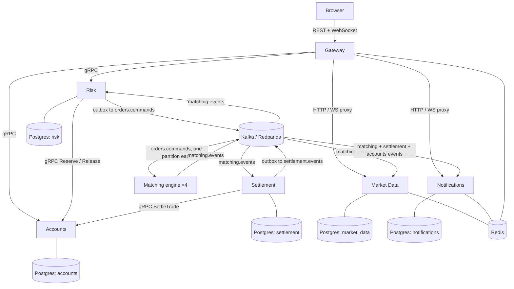

# Oxchange

A simulated stock exchange in Rust: seven services, Kafka (Redpanda), PostgreSQL
and Redis. Users deposit fake money, place orders and trade fake stocks with each
other in real time.

The claim it is built to prove: **kill any service during heavy trading, and no
money or shares are lost or counted twice.** An independent auditor checks that
after every load and failure test.

## Start it

Needs Docker (Desktop) with about 8 GB of memory for the VM.

```bash
docker compose up -d --build --wait
```

Then open:

| What | Where |
|---|---|
| Trading dashboard | http://localhost:3000 (register two users in two browsers and trade) |
| REST API (Gateway) | http://127.0.0.1:8000/v1 |
| Grafana (traces, logs, dashboards) | http://127.0.0.1:3001 |
| Prometheus | http://127.0.0.1:9090 |

Check the books balance (stop traffic first):

```bash
docker compose run --rm auditor --traffic-stopped
```

Run traffic, the failure tests and the Kubernetes deployment:

```bash
docker compose run --rm loadgen --rate 200 --duration 60
```

```bash
python tools/chaos/chaos.py
```

```bash
scripts/k8s.sh up
```

## Architecture



A service makes a gRPC call only when it must have the answer before going on.
Everything else travels through Kafka, so one slow or crashed service does not
stop the others.

The path of one order:

1. `POST /v1/orders` reaches the Gateway, which checks the token and the rate limit.
2. Risk validates it and saves it as `PENDING_RISK`.
3. Risk calls `Accounts.Reserve` to hold the money (buys) or shares (sells).
4. Risk saves `ACCEPTED` and the command to its outbox in one transaction and
   answers 202.
5. The outbox relay publishes the command to `orders.commands`, keyed by stock.
6. The matcher for that partition applies it in log order and writes fills,
   cancels and book changes to `matching.events`.
7. Risk updates the order and releases funds for canceled quantity; Settlement
   calls `Accounts.SettleTrade` for each trade; Market Data streams the public
   book and trades; Notifications tells each user what happened.

| Path | Purpose |
|---|---|
| `crates/domain` | Price, quantity and money types, order rules. No I/O. |
| `crates/order-book` | The book and matching. No async, clock or network. |
| `crates/outbox`, `crates/consumer` | Shared outbox relay; consume loop with sequence checks, retry and partition halt |
| `crates/telemetry` | Metrics, traces and logs for every service |
| `services/*` | gateway, accounts, risk, matching, settlement, market-data, notifications |
| `tools/auditor` | Checks 11 invariants across the databases and the event log |
| `tools/loadgen` | Open-loop load generator |
| `tools/chaos` | The 11 failure tests in one script |
| `web/` | React dashboard |
| `deploy/helm` | Kubernetes chart (also holds the observability configs) |
| `docs/` | Benchmarks, runbooks, failure-test results |

## Main design decisions

**One ordered log per stock.** `orders.commands` is partitioned by stock and
each partition has exactly one matcher. Order is set by the log, not by
timestamps or locks, so a restarted matcher replays the same commands into the
same result. The matcher writes a snapshot every 100,000 commands with the input
offset inside it; recovery loads the newest good snapshot (CRC-checked,
falling back to an older one) and replays from that offset.

**The matching logic is a pure function.** `OrderBook::apply(&Command) ->
events` has no I/O, which makes it deterministic, benchmarkable on its own
(2.6 M commands/s, see [docs/benchmarks/matcher.md](docs/benchmarks/matcher.md))
and testable with millions of random orders.

**Reserve before accepting.** Risk holds funds in Accounts before an order
reaches the book, so a fill can never spend money that is not there. Placing an
order is a saga: if the reply from `Reserve` is lost, Risk voids the
reservation by order id, which also blocks a late `Reserve` from succeeding. A
sweeper finishes orders left half-done by a crash.

**Transactional outbox everywhere.** A state change and the event announcing it
commit in one PostgreSQL transaction; a relay publishes afterwards. No event is
published for a change that rolled back, and none is lost for a change that
committed.

**Every consumer is idempotent.** Matcher events carry a sequence number per stock.
Consumers move their last-seen sequence forward in the same transaction as
the effect, so a repeated event is dropped and a gap halts the partition instead of
skipping money movement. Ledger calls carry idempotency keys; a retry returns
the first result.

**A double-entry ledger.** Balances change only through ledger transactions
whose entries sum to zero per asset. The auditor recomputes balances from the
entries, checks every reservation against open orders, every trade against
exactly one settlement, and the event log for gaps.

**Redis holds only what can be lost.** Ticker, rate-limit buckets, token
revocations and wake-up pub/sub. When Redis is wiped, market orders wait for the
next trade price and everything else carries on.

## Results

Measured on a 2018 laptop (i7-8750H, 6 cores) running everything inside
Docker Desktop; details and caveats in the linked pages.

- **All 11 failure tests pass** in one run, with the auditor finding 0
  problems after each: matcher killed 20 times in 10 minutes (worst recovery
  179 ms), crashes at the exact moment between two writes in Risk and
  Settlement, lost and slow replies from Accounts, 1% duplicated Kafka
  messages, a broker killed, Redis wiped, everything killed at once.
  [docs/failure-tests.md](docs/failure-tests.md)
- **Matching engine alone:** 2.59 M commands/s on one core, p99 1.1 µs.
  [docs/benchmarks/matcher.md](docs/benchmarks/matcher.md)
- **Whole system:** every latency target met at 50 orders/s (order accepted
  p99 46 ms, fill notification 47 ms, settled 92 ms, public trade 26 ms
  with 20 public clients),
  with PostgreSQL on a simulated fast disk. The API accepts 300 orders/s.
  The services consuming the engine's events apply them in batches and keep
  up with 200 orders/s for 30 minutes (one transaction per event held them
  to about 50/s). At 250–300/s the laptop's CPU is the limit. Memory stays
  flat for an hour at 100 orders/s. With 5,000 public clients on the same
  laptop, public trade p99 is 0.7–2.7 s (target 100 ms). On this laptop's own disk
  (about 22 flushes a second) the limit is about 10 orders/s. The spec's
  2,000 orders/s is not reached on this machine. Tuning steps 1–3 are done
  (step 3 simulated); steps 4 and 5 are skipped, with the reasons in the
  report. [docs/benchmarks/system.md](docs/benchmarks/system.md)
- **Matcher recovery** with 138,181 commands to replay: 6.7 s.

## Operations

Every alert links to a runbook in [docs/runbooks](docs/runbooks/README.md).
Grafana has four dashboards (system overview, matching engine, money safety,
Kafka and database), traces that follow one order through every service, and logs
searchable by trace id.
